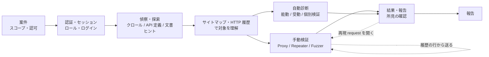
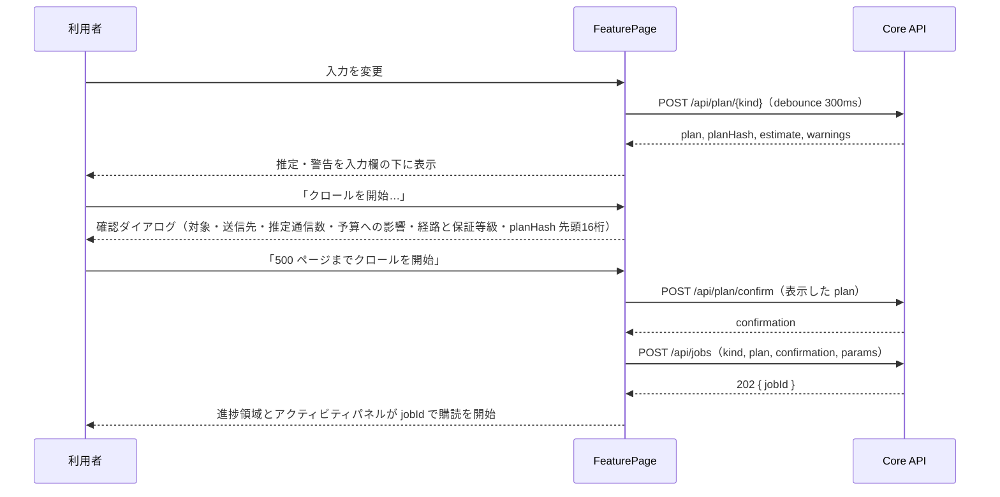

# 40 Advanced モード UI・ワークフロー再設計

対応要件: 仕様書 8章・6.5、AGENTS.md「UI はアドバンスドモードとシンプルモードの2つ」、[23 UI 2モード・移行](23-ui-and-migration.md)、[28 Windows UI 原則](28-windows-ui-guidelines.md)、[22 実行制御](22-execution-control.md)、[18 拡張 API](18-extension-api.md)、[20 保存モデル・証拠](20-storage-evidence.md)

状態: **設計案（オーナー確認待ち）**。承認後、[詳細設計 02](../detailed-design/02-ui-information-architecture.md) §3 の A01〜A13 一覧と `packages/ui/src/app/advanced-nav.ts` を本書の構成に置き換える。承認までは詳細設計 02 が正本である。

調査基準: `C:\Users\GoSugawara\src\ScopePilot2`（`main`、2026-11-10 時点の未コミット 28 ファイルを含む作業状態）。本書の行番号はこの時点の値である。

---

## 0. 要約

| 課題（オーナー認識） | 根本原因（調査結果） | 本設計の対応 |
|---|---|---|
| 各機能が「何をする機能で、何を入力し、どう使うか」が分からない | 画面に目的説明・既定値・入力の意味がない。入力が JSON 手書き・カンマ区切り・自由入力（`direction` を `Input` で入力等）。計画作成→確認→実行が 3 ボタンに分かれ、意味が説明されない | 全画面を共通の **FeaturePage**（目的・入力・実行・進捗・結果・ログ）に統一し、入力項目を **FeatureSpec**（意味・既定値・検証・単位）として宣言する（§4） |
| ZAP と同程度に扱えない | Spider/AJAX Spider/Passive/Scan Policy/Alerts/Contexts/Users/実 Proxy listener/History 詳細が UI に出ていない、またはエンジン内部でしか使われていない | 機能対応表（§2）で不足を特定し、段階計画（§7）で埋める |
| 実行中に何が起きているか分からない | ライブログは Simple の S06（`/api/run/scan/start` の文字列ログ 500 行）にしかない。探索・Fuzzer・テンプレート検証は同期 API で、完了まで応答がない。`/api/events` の SSE は即時に閉じる一括応答で、監査 event はメモリ上のみ | **Job** を全送信操作の共通単位にし、構造化 **JobEvent** を SSE で配信、共通の **アクティビティパネル**と **ジョブ詳細**で表示する（§5） |
| 分類が実装経緯ベース | A08 に文書ヒント登録・探索・API 取込・診断が同居、A10 に Decoder/Comparer/Sequencer/DOM/HTTP2/WebSocket/OAST が同居、A03 にカタログ閲覧と送信を伴う 25 テーマ実行が同居 | 利用者の目的別 9 グループ・33 画面に再編（§3） |

---

## 1. 現状の棚卸し（A01〜A13）

### 1.1 画面ごとの棚卸し

ナビ定義: `packages/ui/src/app/advanced-nav.ts:24-38`、route 権限: `packages/ui/src/app/mode-policy.ts:51-72`、画面の切替: `apps/desktop/src/renderer/advanced.tsx:1107-1201`。

| ID | 画面 | 実装ファイル | 使用 API | 実際にできること | 問題点 |
|---|---|---|---|---|---|
| A01 | Dashboard / Case | `advanced.tsx:1001-1173` | `GET /api/case`、`POST /api/case`、`POST /api/authorization`、`GET /api/capabilities`、`GET /api/runs/interrupted` | 案件名・許可 Origin・上限の表示。案件がなければ Origin 1 つで案件と認可を作成。エンジン能力表（保証等級）、中断 run の一覧 | 案件作成時に認可の操作区分 `['Browse','ActiveScan']`・role `unauthenticated`・期限 30 日・証拠文言がハードコード（`advanced.tsx:1058-1065`）で、利用者が認可内容を確認・入力できない。「次に何をすべきか」が出ない。実行中ジョブ、予算消費、所見件数がない。能力表が A13 と重複 |
| A02 | Scope & Authorization | `advanced.tsx:155-310` | `GET/POST /api/case/scope`、`GET /api/authorization` | 許可/拒否 Origin と上限 3 点の編集（revision 競合を検出）。認可の期間・操作区分・role の表示 | 認可は表示のみで追加・更新できない。scope は Origin 単位の改行テキストのみで、path 除外・禁止操作の編集がない。上限の単位・既定値・案件上限との関係が説明されない。保存で失効した確認の件数しか出ない |
| A03 | Guidelines & Check Catalog | `guidelines-catalog.tsx`（635 行）、`theme-schema.ts` | catalog は bundle の静的 JSON。`GET/POST /api/auth-bypass/checks`、`GET/POST /api/zap-unsupported/checks`、`GET /api/sessions` | 7 標準・871 項目の閲覧・絞り込み。テーマ 1（認証回避）と 25 テーマ（ZAP 非対応）の検証を入力フォームから実行し、履歴を表示 | **閲覧（参照情報）と送信を伴う実行が同居**。実行は同期で進捗・ログがない。どの項目が自動診断で済み、どれが `needs-input` かが一覧で分からない。テーマ番号での提示で、利用者の目的（「CSRF を確かめたい」）から辿れない |
| A04 | Browser / Site map / HTTP history | `advanced.tsx:882-999` | `GET /api/observations`、`GET /api/traffic?limit=500`、`GET /api/traffic/site-map` | 観測ページ表、scope 拒否 URL 一覧、通信履歴（50 件ずつ追加描画、最大 500 件）、endpoint 集約（先頭 15 件） | 名前に「Browser」とあるがブラウザ操作機能はない。**通信の詳細（request/response 本文）を開けない**（API が存在しない）。木構造の site map がない。filter・sort・検索がない。行から Repeater/Fuzzer へ送る操作がない。通信履歴は `trafficLog` のメモリ保持で、再起動で消える |
| A05 | Proxy / Intercept | `proxy-intercept-screen.tsx`（185 行） | `GET /api/proxy/intercept`、`POST .../intake`・`forward`・`drop` | break queue に手入力の message reference を投入し、forward（URL 入力で scope 判定）/drop を行う | **実 proxy listener が未接続**（`ZapProxyAdapter` は adapter と port にのみ存在し、`apps/desktop/src/main` と core application から使われていない）。画面は fixture・検証用の供給点であり、ブラウザ通信の傍受・編集はできない。方向（request/response）を自由入力で指定。request 本文の表示・編集がない |
| A06 | Repeater | `repeater-screen.tsx`（211 行） | `GET /api/repeater`、`POST .../drafts`・`edit`・`send` | URL から draft 作成（上限 20）、header（`Name: value` 行）と body の編集、表示中の plan hash で送信、応答の status・preview 表示 | method・path・query を編集できない（URL 固定）。編集は「適用」ボタンで反映する二段階。raw request の直接編集がない。応答 header・本文全体・時間・差分がない。送信履歴（前回応答との比較）がない。実 transport か fixture かが画面で分からない |
| A07 | Fuzzer | `fuzzer-screen.tsx`（213 行） | `GET/POST /api/fuzzer/payload-sets`、`POST /api/fuzzer/runs` | payload 集合の登録（`sha256: 'manual-entry'` 固定）、`name: v1, v2` 行で position と値を指定して実行、cluster 集約の表示 | **position を request 上で選べない**（URL のみ入力、テキストで名前を書く）。登録した payload 集合を run で選べない。組合せ方式（sniper/cluster bomb 等）・rate・上限が見えない。実行は同期で、進捗・停止がない。個々の応答を開けない。既定値 `user: admin, guest\nid: 1, 2` が入力済み |
| A08 | Scan plans | `advanced.tsx:520-869` | `/api/documents/*-hints`（4 種）、`/api/plan/explore`、`/api/plan/confirm`、`/api/run/explore`、`/api/import/api-spec`、`/api/plan/scan`、`/api/run/scan` | 文書ヒント 4 種の手入力登録、探索計画の作成→確認→実行（同期）、OpenAPI 取込、診断計画の作成→確認→実行（同期） | **1 画面に 5 種の機能が縦積み**（約 30 入力欄）。探索・診断とも同期 API で、完了まで何も表示されない（ZAP 診断は数十分かかりうる）。停止できない（Simple は `/api/run/scan/start` で停止できるのに Advanced は旧同期 API）。対象選択は候補 URL をテキストに流し込むだけで、候補の根拠・優先度を見て選べない。診断に使う経路（ZAP/Nuclei/汎用 HTTP/テーマ）や強度・ポリシーを選べない。上限欄の空欄が `Number.MAX_SAFE_INTEGER` に変換される（`advanced.tsx:502-511`） |
| A09 | Sessions / Roles / Business logic | `sessions-screen.tsx`（306 行） | `/api/sessions`・`flows`・`login`・`refresh`・`cookies`、`/api/documents/auth-hints`、`/api/business-logic/checks` | login flow を **JSON で手書き**して登録、秘密値を入力してログイン実行、session refresh、cookie 名割当、role 間比較の業務ロジック検証 | login flow 作成の支援（記録・AI 推定 `scopepilot:infer-login-form` は Simple にのみある）がない。セッション有効性の確認方法（ZAP の logged-in/out indicator 相当）がない。業務ロジック検証の対象 URL が login の base URL 欄と共用（`sessions-screen.tsx:166-176`）。認証設定と診断（送信）が同居 |
| A10 | Decoder / Comparer / Sequencer | `decoder-comparer-screen.tsx`（882 行） | `/api/tools/decode`・`compare-text`・`sequencer/runs`・`dom-flows`・`transport/*`、`/api/websocket/*`、`/api/oast/*` | codec chain、行差分、token 収集と統計、DOM source/sink 解析、HTTP/2 交渉、WebSocket frame 取込・送信、OAST attempt 発行と callback 手入力記録 | **7 機能の寄せ集め**。送信を伴う機能（Sequencer・HTTP/2・WebSocket・OAST・DOM live）と送信なしの機能（Decoder・Comparer）が同居し、区別表示がない。OAST の callback を手入力する導線（`manual-${Date.now()}`）が本番 UI に露出 |
| A11 | Findings / Organizer / Report | `advanced.tsx:325-461` | `GET /api/findings`、`POST /api/findings/status`、`POST /api/report` | 所見表、確定/棄却（全行共通のメモ欄）、報告生成（ガイドライン `OWASP WSTG 4.2` 固定・本文をテキスト表示） | 所見の詳細（根拠、証拠、再現 request/response）を開けない。メモ欄が全所見で共有され、どの所見の記録か曖昧。filter・group・重複統合がない。報告のガイドラインが固定。Simple S07 の DOCX/Markdown 保存が使えない |
| A12 | Jobs / Evidence / Audit | `advanced.tsx:1174-1187` | `GET /api/events`（NDJSON 一括） | 監査 event の `eventId・type・at` を 1 行ずつ表示（再読込なし） | **名前に反して Jobs も Evidence もない**。event の中身（URL、件数、理由）を表示しない。自動更新なし、filter なし。event はメモリ上で再起動で消える |
| A13 | Settings / Certificates / Engines / AI | `settings-screen.tsx`（204 行） | `GET /api/capabilities`、`/api/extensions`、`/api/certificates/ca*` | 能力表（overshoot・測定時刻・fixture hash）、拡張の登録（`publisherTrusted: true` 固定）、CA プロファイルの信頼切替、AI は説明文のみ | ランタイムツール（ZAP/Nuclei パス）設定は別ウィンドウ（`runtime-settings-window.tsx`、上部「設定」ボタン）にあり、A13 と二重。AI 設定は Simple 側。payload 集合・テンプレート・RulePackage の一覧がない |

### 1.2 横断的な問題

1. **共通シェルの欠落**: 設計 [23 §3](23-ui-and-migration.md) と詳細設計 02 §1 が求める「案件・対象ロール・操作者・モード・認可状態・実行状態」の常時表示がない。上部バーは接続状態・モード・テーマ・言語のみ（`apps/desktop/src/renderer/index.tsx:351-421`）。停止操作も常時表示されない。
2. **操作者権限がハードコード**: `OPERATOR_PERMISSIONS` 定数（`advanced.tsx:23`）。operator 照会 API がない。
3. **画面ごとに API クライアントを複製**: `callJson` が 7 ファイルに重複し、error code・revision 競合・`NeedsInput` の扱いがばらつく。
4. **同期 API と非同期 API の混在**: 送信を伴う POST の大半（`/api/run/explore`、`/api/run/scan`、`/api/fuzzer/runs`、`/api/zap-unsupported/checks`、`/api/auth-bypass/checks`、`/api/business-logic/checks`、`/api/tools/sequencer/runs`）は完了まで応答しない。停止手段がなく、ブラウザ側 fetch がタイムアウトすると結果を失う。
5. **進捗・ログ基盤の分断**: `ActiveScanExecutionEvent`（`baseline-flow.ts:443-450`、phase・engine・message・command・progress）は Simple 用の `scanExecutions` Map（`api-server.ts:250-345`）で文字列化され、500 行で切り捨て、メモリのみ。`BaselineFlowEvent`（`packages/contracts/src/events/events.ts`）は監査用で、`runId`/`jobId` を持たない（`EgressDenied` がどの実行に属するか分からない）。`eventsLog` はメモリ上の配列（`baseline-flow.ts:5217-5219`）で、SQLite に `audit_events` テーブルがない（`packages/storage/src/sqlite/migrations.ts`）。
6. **SSE が streaming になっていない**: `GET /api/events` の `text/event-stream` 応答は既存 event を書いて即 `end()` する（`api-server.ts:1277-1291`）。購読ではなく poll になる。
7. **契約外 route**: `/api/run/scan/start`・`status`・`stop` は `openapi-routes.ts` に載っていない（parity 検査の対象外）。
8. **fixture/実 transport の区別が見えない**: Repeater・Fuzzer・Sequencer・OAST・WebSocket は実 transport 未構成時に fixture 応答で動く（`baseline-flow.ts:237-248`）。画面に表示がなく、利用者は実通信の結果と誤認しうる（[23 §6](23-ui-and-migration.md) の誤解防止に反する）。
9. **ツール間連携がない**: Burp/ZAP の基本操作である「履歴の行 → Repeater/Fuzzer/Comparer に送る」「所見 → 再現 request を開く」「site map → scope に追加/除外」がない。各画面の入力は手入力の URL から始まる。
10. **i18n の不徹底**: A11 の検証記録欄が日本語ハードコード（`advanced.tsx:402-406`）、表 header に英語識別子（`severity`、`itemId`、`engine`）が混在。

---

## 2. Burp Suite / OWASP ZAP との機能対応とギャップ

保証等級は [22 §3](22-execution-control.md) による。「現状」は §1 の調査結果、「新画面」は §3 の画面 ID。

| 機能 | ZAP | Burp Suite Pro | ScopePilot2 現状 | 等級 | ギャップ（ZAP 同等に扱うための不足） | 新画面 |
|---|---|---|---|---|---|---|
| 案件・スコープ | Contexts（include/exclude regex）、Mode（Safe/Protected/Standard/ATTACK） | Target scope（host/path/protocol） | Origin 単位の許可/拒否、上限 3 点（A02） | Enforced | path/regex 単位の除外、禁止操作（logout・削除系）の編集、認可の作成・更新 | A02 |
| サイトマップ | Sites ツリー | Target > Site map | 観測ページ表＋ endpoint 集約 15 件（A04） | — | **木構造**、ノード選択で配下の通信一覧、scope 内外の区別、発見元（crawl/文書/API 定義/proxy）表示 | A20 |
| 通信履歴 | History | Proxy > HTTP history、Logger | 最大 500 件の行表示（A04）、本文なし、メモリのみ | — | **request/response 詳細ペイン**、filter（host/method/status/MIME/source/job/scope）、検索、永続化、10 万件の仮想化（[23 §4](23-ui-and-migration.md)） | A21 |
| 従来型クローラー | Spider | Crawl（Scanner の一部） | Playwright explorer（同期、A08）。ZAP Spider は adapter 内に実装あるが既定無効（`zap-engine.ts:291-294`） | Enforced（Playwright）/ Delegated（ZAP Spider） | 非同期ジョブ化、進捗（訪問数・キュー・拒否）、停止、エンジン選択、深さ・除外パターン・フォーム送信方針の設定 | A22 |
| AJAX Spider | AJAX Spider | Crawl（browser-powered） | ZAP AJAX Spider は adapter 内実装・既定無効。Playwright explorer が SPA を扱う | 同上 | Playwright explorer を「ブラウザクロール」として明示し、ZAP AJAX Spider を任意エンジンとして選べるようにする | A22 |
| 手動ブラウズ記録 | 外部ブラウザ + proxy、HUD | Burp's browser | なし（`interactive-browser.ts` は診断用） | Enforced（Playwright route） | ScopePilot 管理の Playwright ブラウザを開き、操作中の通信を History へ記録する機能 | A22（「手動ブラウズ」モード） |
| API 定義取込 | OpenAPI/GraphQL/SOAP add-on | OpenAPI（BApp 等） | OpenAPI JSON の貼り付け取込（A08） | — | ファイル選択、YAML、取込結果の endpoint 一覧と site map 反映、警告表示 | A23 |
| Proxy / Intercept | Break（request/response） | Proxy > Intercept | break queue のみ。実 listener 未接続（A05） | Enforced（管理 proxy）/ Delegated（ZAP proxy） | **実 listener の接続**、break 条件、raw 編集、forward/drop、CA 証明書導線、ブラウザ起動 | A30 |
| 手動再送 | Requester / Manual Request Editor | Repeater | draft 単位の header/body 編集（A06） | Enforced | raw 編集、method/path 編集、応答の header/本文/時間、送信履歴と前回比較、タブ名、履歴から送る | A31 |
| Fuzzer | Fuzzer | Intruder | 名前・値テキストの組合せ（A07） | Enforced | **request 上での position 指定**、攻撃方式、payload 集合の選択、processor（エンコード等）、rate・上限、非同期実行と停止、結果表（status/長さ/時間/一致）と個別応答 | A32 |
| WebSocket | WebSockets タブ、WS Fuzzer | WebSockets history、Repeater | frame 取込・送信（A10 内） | Enforced | 独立画面、接続ごとの frame 一覧、送信履歴 | A33 |
| OAST | OAST add-on（Interactsh/BOAST） | Collaborator | attempt 発行、callback 手入力（A10 内）。Interactsh provider は adapter に実装 | Enforced | 独立画面、payload のコピー、callback の自動 poll と一覧、相関した所見へのリンク。手入力記録は開発用に隠す | A34 |
| DOM 調査 | DOM XSS add-on | DOM Invader | source/sink 解析（A10 内） | Enforced | 独立画面、観測結果の証拠リンク | A35 |
| 受動診断 | Passive Scan rules、pscan 進捗 | Passive scanning | 内部で `passive` route を記録（`baseline-flow.ts:5129`）、UI なし | — | 受動ルール一覧（有効/無効）、受動所見の表示、処理待ち件数 | A41 |
| 能動診断 | Active Scan（policy・強度・閾値） | Active scan（scan configuration） | 計画作成→確認→実行（同期、A08）。ZAP 強度は Medium 固定 | Delegated（ZAP/Nuclei）/ Enforced（汎用 HTTP） | 非同期ジョブ、経路（ZAP/Nuclei/汎用 HTTP/テーマ）選択、ポリシー選択、対象の候補表からの選択、進捗（ZAP %・messages・経路別状態） | A40 |
| 診断ポリシー | Scan Policy Manager（rule ごと strength/threshold） | Scan configurations | なし | — | 案件単位の**診断ポリシー**（経路・ルール群・強度・閾値・既定）を保存し、計画へ hash 付きで含める | A43 |
| ZAP 非対応項目の検証 | Scripts / 手動 | BApp・手動 | テーマ実行 25 種・認証回避・業務ロジック（A03・A09 に分散） | Enforced | 一か所にまとめ、目的別（ガイドライン項目）に検索し、入力フォーム・非同期実行・ログを共通化 | A42 |
| 既知脆弱性 | （Nuclei 連携なし） | BApp | Nuclei 経路（設定時のみ計画に含む） | Delegated | テンプレート manifest の版・件数表示、診断ポリシーでの選択 | A40 / A43 |
| 認証 | Contexts > Authentication、Users、Forced User、logged-in/out indicator | Session handling rules、macros | login flow（JSON 手書き）・login 実行・refresh（A09） | Enforced（Playwright） | **フロー作成支援**（記録・AI 推定・フォーム推定）、ログイン状態判定条件（indicator）、role ごとの状態表示、再ログイン方針 | A10 / A11 |
| セッション管理 | HTTP Sessions、Session Management | Cookie jar、session handling | cookie 名割当、refresh | Enforced | role ごとの cookie/header の可視化（値はマスク）、有効期限、最終確認時刻 | A11 |
| 認可・アクセス制御 | Access Control add-on | Autorize（BApp） | 認証回避（テーマ 1）、業務ロジック比較 | Enforced | role マトリクス（対象 × role の期待/観測）を A42 のテンプレートとして提供 | A42 |
| Decoder | Encode/Decode/Hash | Decoder | codec chain（A10 内） | 送信なし | 独立画面、hash 計算、履歴から選択文字列を送る | A50 |
| Comparer | （add-on） | Comparer | 行差分（A10 内） | 送信なし | 独立画面、通信 2 件を履歴から選んで比較、バイト差分 | A51 |
| Sequencer | （Token Gen add-on） | Sequencer | token 収集と統計（A10 内、同期） | Enforced | 独立画面、非同期ジョブ化と進捗（サンプル数） | A52 |
| Alerts / Issues | Alerts ツリー | Issues、Dashboard | 所見表と確定/棄却（A11） | — | list/details、所見ごとの検証記録、証拠・再現 request へのリンク、filter/group、重複統合 | A60 |
| 証拠 | Messages 保存 | Project file | `evidence_objects`、run 単位の証拠参照 | — | 証拠ブラウザ（原本/表示用/共有用の区別、hash、出典 job） | A61 |
| 報告 | Report（テンプレート） | Report | 生成と本文表示（A11）、DOCX/MD は Simple のみ | — | ガイドライン選択、プレビュー、DOCX/Markdown 保存、保証レポート（[29](29-assurance-report-template.md)） | A62 |
| 実行状況 | 下部パネル（Spider/Active Scan タブの進捗・停止）、Output | Dashboard > Tasks、Event log | Simple S06 のみ文字列ログ | — | **共通アクティビティパネル**とジョブ詳細（§5） | A70・全画面 |
| 監査ログ | — | Event log | event 種別と時刻のみ（A12） | — | 内容表示、filter、永続化 | A71 |
| エンジン・設定 | Options | Settings | 能力表、別ウィンドウのランタイム設定 | — | 一元化、transport 種別（実/fixture）表示 | A90 |
| CA 証明書 | Dynamic SSL Certificates | Proxy CA | プロファイル信頼切替 | — | Proxy 画面からの導線 | A91 |
| 拡張 | Add-ons Marketplace、Scripts | BApp Store、Extensions | 登録（署名検証は簡易） | — | RulePackage の審査状態表示（[18 §3](18-extension-api.md)） | A93 |

**ZAP 同等に扱うための不足の優先度**（§7 の段階に対応）:

1. 実行の可視化と停止（全送信操作の非同期ジョブ化、ライブログ）— 現状で最大の阻害要因。
2. 通信履歴の詳細表示と「〜に送る」連携（Burp/ZAP の手動検証の基本動線）。
3. クロールの非同期化とエンジン選択（Spider/AJAX Spider/Playwright）。
4. 実 Proxy listener の接続（[03](03-proxy-intercept-logger.md)、f02 の後続増分）。
5. 診断ポリシーと経路選択、受動診断の可視化。
6. 認証フロー作成支援とログイン状態判定。

**ScopePilot2 が ZAP と意図的に異なる点**（設計方針として維持する）:

- 送信はすべて `ExecutionPlan` と `PlanConfirmation` を経る（[22 §2](22-execution-control.md)）。ZAP のように「右クリックで即 Active Scan」はしない。代わりに確認ダイアログを 1 回に集約し、操作数を増やさない（§4.4）。
- ZAP 内部の個々の送信は傍受しない（Delegated）。ZAP 経路の進捗・送信数は「ZAP 報告値（推定）」と明示する（§5.3）。
- ZAP の ATTACK モード相当（発見した URL へ自動で能動診断）は提供しない。子ジョブの新規対象は再確認を要する（[22 §2](22-execution-control.md)）。

---

## 3. 新しい情報設計とナビゲーション

### 3.1 グルーピングの原則

1. **利用者の目的で分ける**。実装の経緯（どの API・どの増分で作ったか）で分けない。
2. **1 画面 1 機能**。同じ画面に入れるのは、同じ入力から同じ種類の結果を得る操作だけとする。
3. **送信の有無を構造で示す**。送信を伴う画面はナビに「送信」アイコンを付け、Decoder/Comparer のような送信しない道具と同じ画面に混ぜない。
4. **参照（設定・カタログ）と実行（送信）を分ける**。ただし実行画面から参照へは 1 クリックで行ける。
5. ナビは左（[28 §3.3](28-windows-ui-guidelines.md)、最上位 9 グループ）。グループ見出しは折りたたみ可能、設定は下端。

### 3.2 新しい画面構成

画面 ID は 2 桁の十の位をグループに割り当てる（後から画面を追加しても番号がずれない）。route ID は `adv.<group>.<feature>` とし、詳細設計 02 の「URL/route ID は共通」に従い Simple と別 route にする。

| グループ（目的） | ID | 画面 | 主な内容 | 送信 | 権限 | 旧画面 |
|---|---|---|---|---|---|---|
| **案件** | A01 | 概要 | 案件・認可・scope の要約、次にやること（チェックリスト）、実行中ジョブ、予算消費、所見件数 | — | case.read | A01 |
| | A02 | スコープ・認可 | 許可/拒否 Origin、path 除外、禁止操作、上限、認可の作成・更新・履歴 | — | case.manage | A01（作成部）、A02 |
| | A03 | ガイドライン・カバレッジ | 対象ガイドラインの選択、項目ごとの実施状況（自動実施済/委譲/要入力/未対応）、項目からの検証画面への導線 | — | case.read | A03（閲覧部） |
| **認証・セッション** | A10 | ロール・ログイン | role 定義、ログインフロー作成（記録・推定・手動）、ログイン状態の判定条件、ログイン実行 | 送信 | run.manage | A09（flow/login） |
| | A11 | セッション | role ごとの session 状態（cookie/header 名、取得時刻、有効性確認、refresh） | 送信 | run.manage | A09（session 表・refresh・cookie） |
| **偵察・探索** | A20 | サイトマップ | 木構造（origin→path）、ノード配下の通信・入力点・発見元、scope への追加/除外 | — | case.read | A04（観測・endpoint） |
| | A21 | HTTP 履歴 | 全通信の仮想化表、filter、request/response 詳細、「〜に送る」 | — | case.read | A04（traffic） |
| | A22 | クロール | エンジン選択（ブラウザクロール / ZAP Spider / ZAP AJAX Spider / 手動ブラウズ記録）、開始点、role、深さ、除外、上限 | 送信 | run.manage | A08（探索部） |
| | A23 | API 定義 | OpenAPI ファイル/貼り付け取込、endpoint 一覧、site map への反映 | — | run.manage | A08（API 取込部） |
| | A24 | 文書ヒント | 受領資料からの URL・認証・優先度・パラメータのヒント（AI 抽出結果と手入力）、未確認表示 | — | case.manage | A08（ヒント 4 種） |
| **手動検証** | A30 | Proxy・Intercept | listener 状態、ブラウザ起動、break 条件、保留キュー、raw 編集、forward/drop | 送信 | run.manage | A05 |
| | A31 | Repeater | タブ、raw request 編集、送信、応答、送信履歴と比較 | 送信 | run.manage | A06 |
| | A32 | Fuzzer | base request、position 指定、攻撃方式、payload 集合、processor、結果表 | 送信 | run.manage | A07 |
| | A33 | WebSocket | 接続一覧、frame 履歴、手動送信 | 送信 | run.manage | A10（WS 部） |
| | A34 | OAST | 相関 ID の発行とコピー、callback の自動受信一覧、所見との相関 | 送信 | run.manage | A10（OAST 部） |
| | A35 | DOM 調査 | source/sink 解析、live 観測 | 送信（live 時） | run.manage | A10（DOM 部） |
| **自動診断** | A40 | 能動診断 | 対象選択（候補表）、ポリシー選択、経路別の内容、確認、実行、経路別進捗 | 送信 | run.manage | A08（診断部） |
| | A41 | 受動診断 | 受動ルール一覧、処理状況、受動所見 | — | case.read | なし（新規） |
| | A42 | 個別検証（テンプレート） | ガイドライン項目・目的から検証テンプレートを選び、入力して実行（ZAP 非対応テーマ、認証回避、role 比較・業務ロジック） | 送信 | run.manage | A03（実行部）、A09（業務ロジック） |
| | A43 | 診断ポリシー | 経路・ルール群・強度・閾値・Nuclei テンプレートの組を名前付きで保存 | — | case.manage | なし（新規） |
| **解析ツール** | A50 | Decoder | codec chain、hash | — | case.read | A10 |
| | A51 | Comparer | テキスト/バイト差分、履歴 2 件の比較 | — | case.read | A10 |
| | A52 | Sequencer | token 収集（送信）と統計 | 送信 | run.manage | A10 |
| **結果・報告** | A60 | 所見 | list/details、検証記録、確定/棄却/統合、証拠と再現 request | — | finding.confirm | A11 |
| | A61 | 証拠 | 証拠一覧（原本/表示用/共有用）、hash、出典ジョブ | — | case.read | A12（名目のみ） |
| | A62 | 報告 | ガイドライン選択、プレビュー、DOCX/Markdown、保証レポート | — | report.export | A11（報告部） |
| **実行管理** | A70 | ジョブ | 全ジョブの一覧と詳細（ライブログ・カウンター・停止）（§5） | — | case.read | A12（名目のみ） |
| | A71 | 監査ログ | 監査 event の内容表示・filter | — | case.read | A12 |
| **設定**（下端） | A90 | エンジン・ランタイム | ZAP/Nuclei/Playwright/Interactsh の版・パス・能力・transport 種別（実/fixture） | — | case.manage | A01 能力表、A13、別ウィンドウ |
| | A91 | 証明書 | CA プロファイル | — | case.manage | A13 |
| | A92 | ライブラリ | payload 集合、検証テンプレート、RulePackage の一覧と版・hash・審査状態 | — | case.manage | A07 登録部、A13 |
| | A93 | 拡張 | 拡張の登録と権限 | — | case.manage | A13 |
| | A94 | AI 支援 | provider/model、認証状態、利用範囲 | — | case.manage | A13（説明のみ）、Simple |

HTTP/2 交渉（旧 A10）は独立画面にせず、Repeater の送信オプション（protocol）と A90 の能力表示に統合する。

### 3.3 ナビゲーションの見え方

```text
┌──────────────────────────┐
│ ▾ 案件                   │
│   概要                   │
│   スコープ・認可         │
│   ガイドライン・カバレッジ│
│ ▾ 認証・セッション       │
│   ロール・ログイン    ⇅  │   ⇅ = 送信を伴う
│   セッション          ⇅  │
│ ▾ 偵察・探索             │
│   サイトマップ           │
│   HTTP 履歴              │
│   クロール         ⇅ ●2 │   ●n = 実行中ジョブ数
│   API 定義               │
│   文書ヒント             │
│ ▾ 手動検証               │
│   Proxy・Intercept ⇅ ⏸3 │   ⏸n = 保留中の要求数
│   Repeater          ⇅    │
│   Fuzzer            ⇅    │
│   WebSocket         ⇅    │
│   OAST              ⇅    │
│   DOM 調査          ⇅    │
│ ▾ 自動診断               │
│   能動診断          ⇅    │
│   受動診断               │
│   個別検証          ⇅    │
│   診断ポリシー           │
│ ▸ 解析ツール             │
│ ▾ 結果・報告             │
│   所見             12    │
│   証拠                   │
│   報告                   │
│ ▾ 実行管理               │
│   ジョブ           ●2    │
│   監査ログ               │
│ ──────────────────────── │
│ ⚙ 設定                   │
└──────────────────────────┘
```

- 「⇅」はアイコン＋ツールチップ「対象へ通信を送信します」。色だけに頼らない（[28 §2.3](28-windows-ui-guidelines.md)）。
- 権限外の画面は従来どおり非表示（`mode-policy` と同じ根拠、UI-UT-013）。
- 幅 1007epx 未満ではアイコンのみ（compact）、640epx 未満ではメニューボタン（minimal）に縮退する。

### 3.4 Advanced の推奨ワークフロー

Advanced は一本道にしないが、初めての利用者のために「概要」に推奨順のチェックリストを置く（ZAP の Quick Start、Burp の Dashboard 相当）。各項目は該当画面へのリンクと完了条件を持つ。



チェックリストの完了条件（`GET /api/workspace/status` で一括取得。§6）:

| 項目 | 完了条件 |
|---|---|
| 1. スコープと認可を設定する | 認可が有効期間内で、許可 Origin が 1 件以上 |
| 2. ガイドラインを選ぶ | 対象ガイドラインが 1 件以上 |
| 3. ロールとログインを設定する（任意） | 認証が必要な role がすべて `authenticated` |
| 4. 対象を探索する | 完了したクロールジョブが 1 件以上、または API 定義の取込が 1 件以上 |
| 5. 診断対象を選ぶ | 採用済み候補が 1 件以上 |
| 6. 診断する | 能動診断ジョブが完了、または個別検証が 1 件以上 |
| 7. 所見を確認する | 未確認（candidate）の所見が 0 件 |
| 8. 報告する | 報告が生成済み |

### 3.5 ツール間連携（コンテキスト操作）

通信・所見・ノードを表示するすべての表で、行のコンテキストメニュー（右クリック、`Shift+F10`）とツールバーに次の共通操作を置く。同じ操作は同じ名前・アイコン・ショートカットにする（[28 §3.4](28-windows-ui-guidelines.md)）。

| 操作 | ショートカット | 対象 | 動作 |
|---|---|---|---|
| Repeater に送る | `Ctrl+R` | 通信、所見の再現 request | 新しい Repeater タブを作り、request を複製（秘密値は参照のまま） |
| Fuzzer に送る | `Ctrl+I` | 通信 | base request として Fuzzer を開く |
| Comparer に送る | — | 通信（2 件） | 左右に設定して差分 |
| Decoder に送る | `Ctrl+Shift+D` | 選択文字列 | 入力に設定 |
| 能動診断の対象に追加 | — | 通信、サイトマップのノード | A40 の対象候補に追加（送信はしない） |
| scope に追加 / 除外 | — | サイトマップのノード | A02 の編集画面を差分付きで開く（保存は A02 で行う。確認の失効を表示） |
| 所見を作成 | — | 通信 | 手動所見の下書きを A60 に作る（証拠に通信を紐付ける） |
| 証拠を開く | — | 所見、ジョブのログ行 | A61 の該当証拠を開く |

---

## 4. 機能画面の共通レイアウト

### 4.1 FeaturePage の構成

すべての Advanced 画面（A01〜A94）は共通コンポーネント `FeaturePage` で組み立てる。送信を伴う画面は「入力 → 実行 → 進捗 → 結果」、送信を伴わない画面は「入力 → 結果」の部分集合を使う。

```text
┌────────────────────────────────────────────────────────────────────────────┐
│ 共通シェル: 案件名 │ 認可: 有効(〜11/30) │ 操作者 │ Advanced │ 実行中 2 │ ■停止 │  ← §4.2
├──────────┬─────────────────────────────────────────────────────────────────┤
│          │ 偵察・探索 › クロール                               [? 使い方] │
│  ナビ    │ サイトを辿ってページと入力点を集めます。送信先は許可 Origin     │  ← 目的（1〜2 文）
│  (§3.3)  │ だけです。 ⇅ 送信あり │ Enforced（ScopePilot が送信前に判定）    │  ← 送信・保証等級
│          ├───────────────────────────────┬─────────────────────────────────┤
│          │ 入力                           │ 結果 / 進捗                     │
│          │ エンジン   [ブラウザクロール▾] │ ┌ 状態: 実行中 03:12  ■停止 ┐ │  ← §4.5
│          │  ⓘ JavaScript を実行して…     │ │ ページ 84/500 ████░░ 17%   │ │
│          │ 開始 URL   [https://…      ]   │ │ 送信 412/5000  拒否 3 エラー 0│ │
│          │  ⓘ 既定: 案件の開始 URL       │ └─────────────────────────────┘ │
│          │ ロール     [admin        ▾]    │ 結果タブ: [ページ][入力点][拒否]│
│          │ 深さ       [5   ] 1〜20        │ ┌──────────────────────────────┐│
│          │ ▸ 詳細設定（除外・上限・速度） │ │ 仮想化された結果表           ││
│          │                                │ └──────────────────────────────┘│
│          │ 推定: 最大 500 ページ /        │                                 │
│          │       5,000 要求（案件残 4,588）│                                 │
│          │ [クロールを開始…]  [既定に戻す]│                                 │
│          ├───────────────────────────────┴─────────────────────────────────┤
│          │ ▾ アクティビティ  [このジョブ][全ジョブ][送信][拒否][エラー]   │  ← §5.4
│          │ 10:02:11 INFO  ブラウザ  /products を訪問（200, 12 リンク）    │
│          │ 10:02:12 WARN  scope    https://cdn.x/… を拒否（許可外 Origin） │
└──────────┴─────────────────────────────────────────────────────────────────┘
│ ステータスバー: ● 実行中 2 │ 予算 412/5,000 │ 拒否 3 │ エラー 0 │ 所見 12 (未確認 9)│  ← §5.5
└────────────────────────────────────────────────────────────────────────────┘
```

| 領域 | 内容 | 規則 |
|---|---|---|
| 見出し | パンくず（グループ › 画面）、画面名、目的 1〜2 文、送信の有無、保証等級、`[? 使い方]` | 目的は「何をして、何が得られるか」を書く。等級は文言＋アイコン（Enforced: 盾、Delegated: 外部矢印） |
| 使い方パネル | 右側 Drawer。「何をする機能か」「入力」「結果の見方」「Burp/ZAP では何に当たるか」「よくある失敗」 | FeatureSpec の `help` から生成（§4.3）。AI 支援 drawer と同じ位置を共有 |
| 入力 | Field（label・説明・既定値・単位・検証メッセージ）。基本項目を上に、詳細は折りたたみ | 既定値は表示し、変更した項目に「既定から変更」マーカー。`[既定に戻す]` |
| 推定 | 計画の推定通信数・ページ数・時間と案件残予算 | 入力変更から 300ms 後に plan preview を取得（§4.4） |
| 実行 | 主要ボタン 1 つ（具体的な動詞）、確認ダイアログ | §4.4 |
| 進捗 | 状態、経過時間、確定/不確定 ProgressBar、カウンター、停止 | §4.5 |
| 結果 | タブ切替の表（list/details） | 「読込中」「打切り」「失敗」「0 件」を区別（[28 §4.2](28-windows-ui-guidelines.md)） |
| アクティビティ | 画面下部の共通パネル（§5.4）。この画面のジョブに自動で絞り込む | 折りたたみ・高さは記憶 |

### 4.2 共通シェル

[23 §3](23-ui-and-migration.md)・詳細設計 02 §1 の要件を満たす上部帯を Advanced と Simple で共有する。

| 項目 | 表示 | 取得元 |
|---|---|---|
| 案件 | 案件名（ホバーで案件フォルダー） | `GET /api/workspace/status` |
| 認可 | `有効（〜2026-11-30）` / `期限切れ` / `未登録`。文言＋アイコン | 同上 |
| 対象ロール | 現在選択中の role（画面横断の既定値） | 同上＋ UI 状態 |
| 操作者・権限 | 操作者名、権限はホバー | `GET /api/operator`（新設） |
| モード | Simple / Advanced 切替 | 既存 |
| 実行状態 | `実行中 2`（クリックでアクティビティパネル） | `GET /api/jobs?state=active` ＋ SSE |
| 停止 | `■ すべて停止`（実行中ジョブがあるときのみ有効） | `POST /api/jobs/stop-all`（新設） |

### 4.3 FeatureSpec（画面と入力の宣言）

画面の説明と入力定義をコードに散らさず、`packages/ui/src/features/feature-spec.ts`（新設、純データ）に宣言する。renderer はこれから見出し・使い方パネル・Field・検証を生成し、unit test で全画面の宣言漏れを検出する。

```ts
// packages/ui/src/features/feature-spec.ts（設計。実装時に確定）
export interface FeatureSpec {
  readonly screenId: string;               // 'A22'
  readonly route: UiRoute;                 // 'adv.recon.crawl'
  readonly group: NavGroupId;              // 'recon'
  readonly titleKey: StringKey;
  readonly purposeKey: StringKey;          // 見出し直下の 1〜2 文
  readonly sendsTraffic: boolean;
  readonly guarantee?: 'Enforced' | 'Delegated' | 'Mixed';
  readonly jobKind?: JobKind;              // 実行するジョブの種類（§5.2）
  readonly permission: OperatorPermission;
  readonly equivalents: { readonly zap?: string; readonly burp?: string };
  readonly help: {
    readonly whatKey: StringKey;           // 何をする機能か
    readonly inputsKey: StringKey;         // 何を入力するか
    readonly resultsKey: StringKey;        // 結果の見方
    readonly pitfallsKey?: StringKey;      // よくある失敗
  };
  readonly fields: readonly FieldSpec[];
}

export interface FieldSpec {
  readonly key: string;
  readonly labelKey: StringKey;
  readonly descriptionKey: StringKey;      // 入力の意味（Field の hint）
  readonly kind: 'text' | 'url' | 'url-list' | 'integer' | 'select' | 'multi-select' | 'boolean' | 'role' | 'request' | 'secret-ref';
  readonly required: boolean;
  readonly defaultValue?: unknown | { readonly from: 'case.startUrl' | 'case.limits.maxRequests' | 'workspace.role' };
  readonly unit?: 'requests' | 'pages' | 'minutes' | 'rps' | 'depth' | 'ms';
  readonly min?: number;
  readonly max?: number | { readonly from: 'case.limits.maxRequests' | 'case.limits.maxPages' | 'case.limits.maxDurationMinutes' };
  readonly options?: readonly { readonly value: string; readonly labelKey: StringKey; readonly descriptionKey?: StringKey }[];
  readonly advanced?: boolean;             // 「詳細設定」に折りたたむ
  readonly validate?: readonly FieldRule[];// 'in-scope-origin' | 'http-url' | 'regex' など宣言的規則のみ
}
```

規則:

- 検証は宣言的規則（`in-scope-origin`、`http-url`、`regex`、`range`）に限り、最終判断は Core の validation（`ValidationFailed`/`OutOfScope`）とする。UI 側の検証は早期表示であって安全保証ではない。
- 空欄を「上限なし」と解釈しない。上限の空欄は「案件上限を使う」と表示し、Core へは値を送らない（現状の `Number.MAX_SAFE_INTEGER` 変換を廃止。Core は既に案件上限へクランプする）。
- 自由入力の列挙値（現状の方向 `request/response`、優先度カテゴリ `pii/payment`、認証方式）は `select` にする。
- JSON 手書き入力（login flow の steps）は廃止し、手順エディタ（§4.6 A10）にする。JSON は「詳細: JSON で編集」として残す。

### 4.4 実行と確認（計画作成→確認→実行の集約）

現状の A08 は「計画を作成」「確認」「実行」の 3 ボタンで、利用者に `ExecutionPlan`/`PlanConfirmation` の内部手順を押し付けている。安全モデル（[22 §2](22-execution-control.md)）は変えずに、操作を次の形にまとめる。



- 確認ダイアログはモーダル 1 回のみ（[28 §10](28-windows-ui-guidelines.md)「送信前の最終確認だけを Dialog」）。主ボタンは具体的な動詞と数量（「500 ページまでクロールを開始」）、既定フォーカスはキャンセル。
- ダイアログ表示後に plan hash が変わったら（入力変更・scope 変更・認可失効）主ボタンを無効化し、理由を示す（UI-UT-005 の既存規則）。
- Repeater の 1 件送信は、案件で「単発送信の確認を省略」を有効にした場合に限り、ダイアログを出さずインラインの確認（送信先・role を送信ボタン横に常時表示）にできる。省略設定自体は監査 event に残す。**未決事項 Q3**。

### 4.5 進捗表示の規則

| 状態 | 表示 |
|---|---|
| 計画中（plan preview 取得中） | 推定欄に Skeleton |
| 待機（Queued） | 「開始待ち（同時実行上限）」＋順番 |
| 実行中・総量が分かる | 確定 ProgressBar＋「84 / 500 ページ」 |
| 実行中・総量が不明（ZAP Spider 等） | 不確定 ProgressBar＋件数（「訪問 84」） |
| 停止要求中（Stopping） | 「停止しています（エンジンの応答待ち）」＋経過秒 |
| 終了 | 終了状態（完了/停止/失敗/中断）、停止理由（`StopReason` を文言化）、所要時間、件数要約、「結果を見る」「ログを開く」 |

10 秒を超えうる処理は停止ボタンを必ず表示する（[28 §4.2](28-windows-ui-guidelines.md)）。

### 4.6 主要画面の入力仕様

各画面の FeatureSpec の初版。既定値は現行コードの値を踏襲し、出典を記す。「上限」は案件上限（A02）を超えられず、超える値は Core がクランプして警告を返す。

#### A22 クロール

目的: 「サイトを辿ってページ・リンク・フォーム・API 呼び出しを集め、サイトマップと診断候補を作ります。」

| 項目 | 意味 | 種別 | 既定値 | 検証 |
|---|---|---|---|---|
| エンジン | ブラウザクロール（Playwright、JS 実行・SPA 対応）／ ZAP Spider（HTML リンク解析、高速）／ ZAP AJAX Spider（ZAP 内ブラウザ）／ 手動ブラウズ記録 | select | ブラウザクロール | ZAP 系は ZAP 未構成なら無効（理由をツールチップ） |
| 開始 URL | 辿り始める URL。複数可 | url-list | 案件の開始 URL | 許可 Origin 内（`in-scope-origin`） |
| ロール | このロールのセッションでクロールする。空欄は未認証 | role | 共通シェルの選択 role | 登録済みかつ `authenticated` の role |
| 最大深さ | 開始 URL からのリンク段数 | integer, depth | 5（`advanced.tsx:683`） | 1〜20 |
| 文書ヒントを開始点に含める | A24 の未確認 URL を追加の開始点にする | boolean | ON | — |
| 除外パターン（詳細） | 辿らない URL の正規表現（ログアウト等） | text（複数行） | 案件の禁止操作から生成 | 正規表現として妥当 |
| フォーム送信（詳細） | 送信しない／GET フォームのみ／すべて（禁止操作を除く） | select | GET フォームのみ | 「すべて」は認可に `StateChange` 相当が必要 |
| 最大ページ数・最大要求数・最大時間（詳細） | 上限 | integer | 案件上限 | 1〜案件上限 |

結果タブ: 「ページ」（URL・status・title・発見元・深さ）、「入力点」（URL・method・パラメーター）、「拒否」（URL・理由）、「診断候補」（A40 で採用）。

#### A40 能動診断

目的: 「選んだ対象に診断用の要求を送り、脆弱性の候補（所見）を集めます。ZAP・Nuclei は外部エンジンに委譲し、ScopePilot の汎用 HTTP 診断は送信前に範囲を判定します。」

| 項目 | 意味 | 種別 | 既定値 | 検証 |
|---|---|---|---|---|
| 対象 | 診断する要求（URL・method・入力点）。候補表から選ぶ | 候補表の複数選択（根拠・優先度・発見元・前回診断を列表示） | 未選択（文書ヒントの高優先候補を先頭に並べる） | 1 件以上、許可 Origin 内 |
| ロール | 診断時のセッション | role | 共通シェルの選択 role | `authenticated` の role |
| 診断ポリシー | 経路と強度の組（A43） | select | 「標準」（ZAP Medium、汎用 HTTP 9 観点、Nuclei 設定時のみ） | 案件で有効なポリシー |
| 経路 | ZAP 能動診断 / Nuclei / 汎用 HTTP 診断 / ガイドラインのテーマ実行 / ブラウザ検証。ポリシーから決まり、ここでは個別に外せる | multi-select（等級を併記） | ポリシーどおり | 能力が `unavailable` の経路は選択不可 |
| ガイドライン | 所見と実施範囲を対応付けるガイドライン | multi-select | A03 で選択済みのもの | 1 件以上 |
| 上限（詳細） | 要求数・時間・同時実行・速度 | integer | 案件上限・安全規定値 | 案件上限・`PLAN_SAFETY_CEILING` 以内 |

進捗は経路ごとの行（ZAP: % と messages（推定）、汎用 HTTP: 観点 n/9・送信数、Nuclei: 行数、ブラウザ検証: n/5）で表示する（`runActiveScan` の既存 emit を構造化して利用。§5.6）。

#### A31 Repeater

| 項目 | 意味 | 種別 | 既定値 | 検証 |
|---|---|---|---|---|
| request | method・URL・header・body を raw で編集 | request エディタ（等幅、構文色、秘密値は参照表示） | 「〜に送る」元の request、または空の `GET` | 送信先が許可 Origin 内。Host と接続先の不一致は警告 |
| ロール | セッションを適用する role | role | 共通シェルの選択 role | — |
| プロトコル | HTTP/1.1 / HTTP/2（交渉結果を表示） | select | HTTP/1.1 | HTTP/2 は能力が有効なときのみ |
| リダイレクト | 追従しない / 1 段ずつ確認して追従 | select | 追従しない（[22 §4](22-execution-control.md)） | — |

結果: 応答（status・header・body・時間・サイズ）、送信履歴（同タブ内の過去送信の一覧と、選択 2 件の差分）。現状の「適用」ボタンは廃止し、送信時に draft を保存・plan hash を更新する（hash の意味は不変）。

#### A32 Fuzzer

| 項目 | 意味 | 種別 | 既定値 | 検証 |
|---|---|---|---|---|
| base request | 変化させる元の要求 | request エディタ | 「Fuzzer に送る」元 | 許可 Origin 内 |
| position | 値を差し替える箇所。エディタ上で選択して「§ 追加」、またはパラメーター名から自動検出 | request 上のマーカー | 未設定（「自動検出」ボタンで query/body/cookie のパラメーターを提示） | 1 か所以上 |
| 攻撃方式 | 単一（各 position を順に）／ 同値（全 position に同じ値）／ 並行（position ごとの集合を同じ行で）／ 総当たり（全組合せ） | select（Burp の Sniper/Battering ram/Pitchfork/Cluster bomb を説明に併記） | 単一 | 総当たりは組合せ数が上限超過なら送信前に拒否（既存の組合せ上限検証） |
| payload | position ごとの payload 集合（A92 のライブラリから選択、または直接入力） | select ＋ text | なし | 集合は供給元・版・hash 付き |
| processor（詳細） | URL エンコード、Base64、接頭辞/接尾辞 | multi-select | なし | — |
| 速度・上限（詳細） | rps・最大要求数 | integer | 安全規定値・案件上限 | 推定組合せ数 ≤ 最大要求数 |

結果表: payload・status・長さ・時間・cluster・一致条件（文字列/正規表現）を列にし、行選択で request/response を表示する。

#### A30 Proxy・Intercept

| 項目 | 意味 | 種別 | 既定値 |
|---|---|---|---|
| listener | 待ち受けアドレスと状態（停止中/待受中）、使用エンジン（管理 proxy / ZAP） | 表示＋開始/停止 | 停止中 |
| ブラウザ | ScopePilot 管理のブラウザを proxy 設定済みで開く | ボタン | — |
| 傍受 | 傍受の ON/OFF、条件（scope 内のみ / 拡張子除外 / method） | boolean ＋ 条件 | OFF、scope 内のみ、静的ファイル除外 |
| 保留キュー | 保留中の要求（方向・URL・残り時間）。選択で raw 編集 | list/details | — |

操作: 転送（`Ctrl+F`）、破棄（`Ctrl+D`）、Repeater に送る。編集後の送信先が scope 外なら転送を拒否し理由を表示（既存 `forward` の decision）。

#### A10 ロール・ログイン

| 項目 | 意味 | 種別 | 既定値 |
|---|---|---|---|
| role | 対象サイトの利用者種別（認可に登録された role から選ぶ） | role | 認可の先頭 role |
| ログイン方法 | フォーム（推定）／ 手順を記録／ 手順を手で組む／ 外部で取得した cookie・header を登録 | select | フォーム（推定） |
| ログインページ URL | — | url | 文書ヒントの認証情報、なければ空 |
| 手順 | 移動・入力・クリック・待機・確認の列。入力値は秘密値参照（`secret-ref`） | 手順エディタ | 推定結果（`scopepilot:infer-login-form` を Advanced からも使う） |
| ログイン成功の判定 | URL 前方一致 / 本文に含む / 本文に含まない / status | select ＋ 値 | URL 前方一致（現行 `expectedUrlPrefix`） |
| ログアウト判定（詳細） | 診断中のセッション切れを検出する条件（ZAP の logged-out indicator 相当） | select ＋ 値 | なし |

#### A42 個別検証（テンプレート）

目的: 「ZAP では確かめられない項目を、承認済みのテンプレートで ScopePilot が送信して確かめます。」

- 左: テンプレート一覧。ガイドライン項目（A03）、目的のキーワード（CSRF、認可、レート制限…）、テーマ番号で検索。各行に必要入力・送信数の目安・Simple での扱い（自動/要入力）。
- 右: 選択テンプレートの FeaturePage。入力は `theme-schema.ts` の `ThemeSchema`（required/secret/boolean/select、namedTargets）を FieldSpec へ写像する。認証回避（テーマ 1）と業務ロジック（role 比較）も同じテンプレート形式に揃える。
- 実行は `jobKind: 'template-check'` の非同期ジョブ（§5）。

#### その他の画面

A02・A20・A21・A23・A24・A33・A34・A35・A41・A43・A50〜A52・A60〜A62・A70・A71・A90〜A94 も同じ形式で FeatureSpec を持つ。実装時に `packages/ui/test/unit/features/feature-spec.test.ts` が「全 route に FeatureSpec があり、送信画面は `jobKind` と `guarantee` を持ち、全 field に description と既定値の扱いがある」ことを検査する（§7.2）。

---

## 5. 実行中ログ・進捗の可視化

### 5.1 現状の仕組みと不足

| 仕組み | 実体 | 用途 | 不足 |
|---|---|---|---|
| 監査 event | `BaselineFlowEvent`（34 種）、`BaselineFlowService.eventsLog`（メモリ配列）、`GET /api/events`（NDJSON / 一括 SSE） | 案件・計画・実行・所見の監査 | 永続化なし、`jobId/runId` なし（`EgressDenied` 等の帰属不明）、streaming なし、A12 で種別と時刻しか見えない |
| 実行進捗 | `ActiveScanExecutionEvent`（phase・engine・message・command・progress）、`api-server.ts` の `scanExecutions` Map | Simple S06 のライブログ | 能動診断だけ、文字列化して 500 行で切り捨て、メモリのみ、契約外 route、poll 前提、件数カウンターなし |
| run 記録 | `runs` テーブル、`RunRecord`（state・stopReason）、`GET /api/runs/interrupted` | 状態遷移と中断検出 | 一覧・詳細 API がない、カウンターなし |
| 通信索引 | `trafficLog`（メモリ）、`GET /api/traffic`、`SiteMapProjector` | 履歴表示 | 永続化なし、詳細なし、ジョブとの関連なし |
| 証拠 | `evidence_objects`、`requestCorpusEvidenceRef` 等 | 原本保存 | 一覧・取得 API がない |

### 5.2 Job モデル（全送信操作の共通単位）

送信を伴う操作はすべて **Job** として起動し、同じ API・同じ event・同じ UI で扱う。`RunRecord` は「plan を確認して実行した 1 回」であり、Job はその実行を UI・ログ・カウンターの観点で包む（1 Job = 1 run を原則とし、子計画は子 Job として `parentJobId` で結ぶ）。

| `JobKind` | 起動元画面 | 既存の domain 処理 | 現 API（同期） |
|---|---|---|---|
| `crawl` | A22 | `runExploration` | `POST /api/run/explore` |
| `active-scan` | A40 | `runActiveScan` | `POST /api/run/scan`、`/api/run/scan/start` |
| `fuzz` | A32 | `runFuzzSession` | `POST /api/fuzzer/runs` |
| `repeater-send` | A31 | `sendRepeaterDraft` | `POST /api/repeater/send` |
| `template-check` | A42 | `runZapUnsupportedCheck`・`runAuthBypassCheck`・`runBusinessLogicCheck` | 各 `POST .../checks` |
| `login` | A10・A11 | `runLogin`・`refreshSession` | `POST /api/sessions/login`・`refresh` |
| `sequencer` | A52 | `runSequencerSession` | `POST /api/tools/sequencer/runs` |
| `ws-send` | A33 | `sendWsMessages` | `POST /api/websocket/send` |
| `oast-poll` | A34 | `startOastAttempt`＋provider poll | `POST /api/oast/attempts` |
| `dom-observe` | A35 | `analyzeDomFlows`（live 時） | `POST /api/tools/dom-flows` |
| `interactive-diagnostics` | Simple S06 | `runInteractiveDiagnostics` | `POST /api/diagnostics/interactive` |
| `proxy-session` | A30 | proxy listener（実装後） | なし |
| `report` | A62 | `generateReport`（送信なし、長時間になりうるため Job 化） | `POST /api/report` |

状態は `RunState` の実行部分（`Running → Stopping → Completed | Stopped | Failed | Interrupted`）に `Queued` を加える。詳細設計 01 と design/22 の状態名の不一致（仕様把握レポート 7 章 4）は、本書では `packages/contracts/src/common/runtime.ts` の `RunStates`（design/22 系）を正とする。

```ts
// packages/contracts/src/jobs/jobs.ts（新設。設計）
export type JobState = 'Queued' | 'Running' | 'Stopping' | 'Completed' | 'Stopped' | 'Failed' | 'Interrupted';

export interface JobCounters {
  readonly requestsSent: number;           // ScopePilot が送信した数（Enforced。確定値）
  readonly requestsReportedByEngine?: number; // 外部エンジンの報告値（Delegated。推定）
  readonly budget: { readonly leased: number; readonly used: number; readonly limit: number };
  readonly pagesVisited?: number;
  readonly queued?: number;                // 未処理キュー（クロール等）
  readonly deniedByScope: number;
  readonly errors: number;                 // 送信失敗・タイムアウト・5xx
  readonly warnings: number;
  readonly findings: number;               // このジョブで新規に作られた所見
  readonly progress?: { readonly done: number; readonly total?: number; readonly unit: 'pages' | 'requests' | 'checks' | 'percent' | 'samples' };
}

export interface JobSummary {
  readonly jobId: string;
  readonly kind: JobKind;
  readonly parentJobId?: string;
  readonly runId?: string;
  readonly planHash?: string;
  readonly label: string;                  // 「クロール: https://shop.example (admin)」
  readonly role?: string;
  readonly state: JobState;
  readonly stopReason?: StopReason;
  readonly guarantee: 'Enforced' | 'Delegated' | 'Mixed';
  readonly transport: 'live' | 'fixture';  // fixture 応答で動いた場合は必ず 'fixture'
  readonly createdAt: string;
  readonly startedAt?: string;
  readonly endedAt?: string;
  readonly counters: JobCounters;
  readonly lastEventSeq: number;
}
```

### 5.3 JobEvent（構造化ライブログ）

```ts
// packages/contracts/src/jobs/job-events.ts（新設。設計）
export type JobEventCategory =
  | 'lifecycle'   // 状態遷移（開始・停止要求・完了）
  | 'phase'       // 経路・段階の開始/終了（ZAP 開始、汎用 HTTP 観点 3/9 開始…）
  | 'request'     // ScopePilot が送信した要求の要約（method・URL・status・時間・exchangeId）
  | 'egress-denied' // scope 外・禁止操作で送信前に拒否
  | 'budget'      // lease 取得・枯渇・overshoot 予約
  | 'engine-log'  // 外部エンジンの出力（ZAP 進捗・Nuclei stderr 行）
  | 'finding'     // 所見の新規作成・重複統合
  | 'warning'     // 継続可能な問題（429 による減速、認証切れ検知）
  | 'error';      // 経路の失敗（独立失敗を含む）

export interface JobEvent {
  readonly seq: number;                    // 案件内で単調増加（SSE の event ID）
  readonly jobId: string;
  readonly at: string;
  readonly level: 'debug' | 'info' | 'warn' | 'error';
  readonly category: JobEventCategory;
  readonly source: 'scopepilot' | 'zap' | 'nuclei' | 'playwright' | 'interactsh' | 'engine';
  readonly route?: string;                 // 'zap-active' | 'workflow-scan:sql-error' | 'zap-unsupported:13' ...
  readonly messageKey: string;             // 'job.request.sent' 等。表示文言は renderer の resources で解決
  readonly params: Readonly<Record<string, string | number | boolean>>;
  readonly message: string;                // 既定言語の整形済み文（CLI・ログ書出し用）
  readonly estimated?: boolean;            // Delegated の推定値を含む event
  readonly counters?: Partial<JobCounters>;// この event 時点の差分または絶対値
  readonly refs?: {
    readonly exchangeId?: string;          // HTTP 履歴の行
    readonly evidenceId?: string;          // 証拠
    readonly findingId?: string;
    readonly url?: string;
    readonly command?: string;             // 外部コマンド（秘密値は伏せ字済み）
  };
}
```

規則:

1. **秘密値を載せない**。Cookie・Authorization・入力された秘密値は event 生成時に伏せ字にする（`workflow-scan-transport` の既存マスクと同じ規則）。`command` も伏せ字済みのものだけを載せる。
2. **Delegated の数値は推定と明示**。ZAP の `messageCount` は `requestsReportedByEngine` と `estimated: true` で運び、ScopePilot の確定送信数（`requestsSent`）と合算しない（[22 §3](22-execution-control.md)）。
3. **`request` event は要約のみ**。本文は通信索引と証拠に置き、`exchangeId` で参照する。高頻度送信（Fuzzer 等）では 1 秒ごとに集約 event（`job.request.batch`、件数・status 分布）を出し、個別行は HTTP 履歴で見る。保存・配信量の上限を設ける（§5.7）。
4. **監査 event との関係**: `BaselineFlowEvent` は監査の正本として残し、`jobId`・`runId` を任意フィールドとして追加する。JobEvent はライブログの正本で、監査 event のうち実行に属するもの（`RunStarted`・`RunCompleted`・`EgressDenied`・`FindingsImported` 等）は対応する JobEvent も同時に発行する。一方を他方から導出しない（用途と保持期間が違う）。

### 5.4 共通アクティビティパネル

全 Advanced 画面の下部に置く共通パネル（ZAP の下部タブ、IDE の出力パネル相当）。Simple の S06 も同じコンポーネントを簡易表示で使う。

```text
┌ アクティビティ ─────────────────────────────────────────────────────────────── ▾ ┐
│ [ジョブ 2●] [ログ] [送信] [拒否 3] [エラー 0]      🔍 [絞込…] 水準[INFO▾] 出典[全て▾] ⏸自動スクロール │
├────────────────────────────────────────────────────────────────────────────────┤
│ ジョブタブ:                                                                    │
│ ● クロール: shop.example (admin)   実行中 03:12  ページ 84/500  送信 412  拒否 3  ■ │
│ ● 能動診断: 12 対象 (標準)        実行中 10:40  ZAP 37% (推定 1,820)  所見 4  ■ │
│ ✓ Repeater: GET /api/users/1     完了  200  143ms                              │
├────────────────────────────────────────────────────────────────────────────────┤
│ ログタブ（選択ジョブ、または全ジョブ）:                                        │
│ 10:40:02 INFO  ZAP      active scan 37%（messages 1,820・推定）                │
│ 10:40:03 INFO  汎用HTTP sql-error 観点を開始（12 候補）                        │
│ 10:40:04 WARN  scope    https://cdn.example/… を拒否（許可外 Origin）  [詳細] │
│ 10:40:05 INFO  所見     「SQL エラーの露出」/search?q=  [所見を開く][証拠]     │
└────────────────────────────────────────────────────────────────────────────────┘
```

| タブ | 内容 | データ |
|---|---|---|
| ジョブ | 実行中・最近のジョブ（状態・経過・主要カウンター・停止）。行クリックで A70 の詳細 | `GET /api/jobs` ＋ SSE `job.updated` |
| ログ | JobEvent の時系列（選択ジョブ、未選択なら全ジョブ） | SSE `/api/jobs/events` |
| 送信 | `request` event（method・URL・status・時間・ジョブ）。行で HTTP 履歴の詳細へ | 同上（category=request） |
| 拒否 | `egress-denied`（URL・理由・ジョブ）。理由は文言化（許可外 Origin / 拒否 Origin / 禁止操作 / 別 Origin への資格情報転送 / DNS 再解決不一致） | 同上 |
| エラー | `error`・`warning`（経路・内容・対処）。エラー文は「何が→なぜ→どうすれば」（[28 §4.3](28-windows-ui-guidelines.md)） | 同上 |

フィルター: 水準（debug/info/warn/error、既定 info 以上）、出典（scopepilot/zap/nuclei/playwright/interactsh）、経路（route）、カテゴリ、テキスト検索、ジョブ。フィルター状態は画面ごとに記憶し、FeaturePage 内では「このジョブ」が既定。

操作: 自動スクロールの一時停止（手動スクロールで自動停止、末尾で再開）、行のコピー、表示中ログの書き出し（NDJSON/テキスト、伏せ字済み）、行のリンク（exchangeId → HTTP 履歴、evidenceId → 証拠、findingId → 所見）。

アクセシビリティ: ログ行の追加は `aria-live` にしない（読み上げが洪水になる）。状態遷移（開始・完了・停止・失敗）と error だけを `role="status"` の live region で通知する。ログ表は仮想化し、キーボードで行移動できる（[23 §4](23-ui-and-migration.md)）。

### 5.5 ステータスバー

ウィンドウ最下部に常時表示し、クリックでアクティビティパネルの該当タブを開く。

```text
● 実行中 2 │ 予算 2,232 / 5,000 要求（残 2,768）│ 拒否 3 │ エラー 0 │ 所見 12（未確認 9）│ ZAP 2.16.0 接続 │ 実通信
```

- 予算は案件共有上限（[22 §3](22-execution-control.md)）の lease 消費。Delegated の overshoot 予約分は別表示（「うち予約 120」）。
- 「実通信 / fixture」は transport の種別。fixture で動いている機能がある場合は「一部 fixture」と表示し、クリックで A90 の該当行を開く（§1.2-8 の解消）。

### 5.6 ジョブ詳細（A70）

```text
┌ 能動診断: 12 対象（標準ポリシー）・role admin ───────────── 実行中 10:40  [■ 停止] ┐
│ plan 3f9a1c…（確認 11/10 10:29 by g.sugawara）  run r-0192  認可 a-001             │
├───────────────────────────────────────────────────────────────────────────────────┤
│ 経路                 等級        状態      進捗                 送信     所見     │
│ ZAP 能動診断         Delegated   実行中    37%（推定 1,820）     —       2        │
│ 汎用 HTTP 診断       Enforced    実行中    観点 4/9             412      2        │
│ テーマ 13 CORS       Enforced    完了      ✓                    6        0        │
│ Nuclei               Delegated   待機      —                    —        —        │
│ ブラウザ検証         Enforced    未開始    0/5                  —        —        │
├───────────────────────────────────────────────────────────────────────────────────┤
│ カウンター: 送信 418（確定）＋ ZAP 1,820（推定） │ 予算 2,232/5,000 │ 拒否 3 │ エラー 0 │
├───────────────────────────────────────────────────────────────────────────────────┤
│ [ログ] [送信] [拒否] [所見] [証拠] [計画]                                          │
│  … アクティビティパネルと同じ表（このジョブに固定）…                               │
└───────────────────────────────────────────────────────────────────────────────────┘
```

- 経路表は既存の `diagnosticRoutes`・`guidelineRoutes`（`executed/delegated/needs-input/unavailable`）を実行中から表示する。`needs-input` の行には「A42 で入力して実行」へのリンク。
- 「計画」タブは確認した plan（対象・上限・経路・hash）を読み取り専用で表示する。
- 終了後も同じ画面で再表示できる（event と counters は永続化。§5.7）。
- 中断ジョブ（`Interrupted`）は再開ではなく「同じ条件で新しい計画を作る」を提示する（[22 §6](22-execution-control.md)）。

### 5.7 配信・保存・上限

| 項目 | 設計 |
|---|---|
| 配信 | `GET /api/jobs/events`（全ジョブ）と `GET /api/jobs/{jobId}/events` を **streaming SSE** にする。接続を保持し、新しい event を逐次 `write`。`Last-Event-ID`（= `seq`）で再接続時に欠落分を再送。15 秒ごとに `: keep-alive` コメント。NDJSON（`Accept: application/x-ndjson`）は CLI 向けに一括取得を残す |
| 監査 event | `GET /api/events` も同様に streaming 化し、[18 §6](18-extension-api.md) の `/v1/events` 方針に合わせる |
| 保存 | SQLite に `jobs`（JobSummary）・`job_events`（seq・jobId・category・level・JSON）・`audit_events` を追加。`runs/<run-id>/engine/` に外部エンジンの stdout/stderr 原本（上限付き、[20 §2](20-storage-evidence.md)） |
| 上限 | 1 ジョブあたり `job_events` は既定 50,000 行。超過分は `request` を集約 event に置き換え、`warning`・`error`・`egress-denied`・`finding`・`lifecycle` は捨てない。切り捨てた事実を `job.events.truncated` で記録 |
| renderer | メモリには表示窓＋ 5,000 行のリングバッファのみ。それ以前はスクロール時に `?before=seq&limit=500` で取得 |
| 復元 | renderer の再読込・モード切替でジョブは止まらない（[23 §4](23-ui-and-migration.md)）。起動時に `GET /api/jobs?state=active` で復元し、`lastEventSeq` から購読を再開 |
| 頻度 | counters 更新は 1 秒に 1 回まで集約（`job.updated`）。UI の再描画も同頻度 |

### 5.8 既存仕組みからの移行

1. `api-server.ts` の `scanExecutions` Map を Core の `JobRegistry`（`packages/core/src/application/job-registry.ts`、新設）に移す。`runActiveScan` の `onEvent`（`ActiveScanExecutionEvent`）は JobRegistry が JobEvent に変換する。message 文字列はそのまま `message` に、phase・engine・progress・command は構造化フィールドへ写す。
2. `/api/run/scan/start`・`status`・`stop` は JobRegistry 上の互換 route として残し、OpenAPI に載せて parity 検査に含める。`status.logs`（文字列配列）は JobEvent から生成する。Simple S06 は P2 で `/api/jobs` に移行し、互換 route は 1 リリース後に廃止する。
3. `runExploration` に `onEvent`（訪問・キュー・拒否）を追加し、Playwright explorer の port（`packages/core/src/ports/engines.ts`）に進捗 callback を足す。adapter 側は訪問ごとに 1 回呼ぶ。
4. `EgressPolicy` の拒否（`baseline-flow.ts:4079-4106` の `EgressDenied` 記録）に実行中 jobId を渡し、`egress-denied` JobEvent を同時発行する。
5. 送信経路（repeater/fuzz/workflow-scan/sequencer transport）の `recordObservedExchange`（`baseline-flow.ts:830`）に jobId を渡し、通信索引の行に `jobId` を持たせる。

---

## 6. Core API・contracts・イベントの変更点

### 6.1 contracts

| 種別 | 対象 | 変更 |
|---|---|---|
| 新設 | `packages/contracts/src/jobs/jobs.ts` | `JobKind`、`JobState`、`JobCounters`、`JobSummary`、`StartJobRequest`（kind ごとの判別共用体） |
| 新設 | `packages/contracts/src/jobs/job-events.ts` | `JobEvent`、`JobEventCategory`、`messageKey` の一覧（renderer の resources と対応させ、unit test で欠落検出） |
| 変更 | `packages/contracts/src/events/events.ts` | 実行に属する event（`RunStarted`・`RunCompleted`・`EgressDenied`・`FindingsImported`・`FuzzRunCompleted`・`*CheckCompleted`・`LoginCompleted`・`SequencerSessionCompleted`・`Oast*`・`Ws*`）に任意の `jobId`・`runId` を追加。追加は後方互換（[18 §2](18-extension-api.md)） |
| 新設 | `packages/contracts/src/traffic/` | `ExchangeSummary`（`jobId`・`role`・`inScope`・`source` を追加）、`ExchangeDetail`（表示用派生物の request/response、伏せ字規則版、証拠参照） |
| 新設 | `packages/contracts/src/scan/scan-policy.ts` | `ScanPolicy`（名前、経路の有効/無効、ZAP 強度・閾値、汎用 HTTP 観点、Nuclei テンプレート条件、版、hash）。`ExecutionPlan` に `scanPolicyHash` を含める（plan hash に影響） |
| 新設 | `packages/contracts/src/case/workspace-status.ts` | `WorkspaceStatus`（案件、認可状態、role 状態、実行中ジョブ数、予算、所見件数、チェックリスト完了状況、transport 種別） |
| 変更 | `packages/contracts/src/engines/` | `EngineCapabilitySnapshot` に `transport: 'live' \| 'fixture'` を機能ごとに追加（repeater/fuzz/sequencer/oast/websocket/http2/dom） |
| 新設 | `packages/ui/src/features/feature-spec.ts`（UI 層） | §4.3 の `FeatureSpec`・`FieldSpec`。API 契約ではないが、`UiRoute` と同じく packages/ui に置く |
| 変更 | `packages/ui/src/app/mode-policy.ts`・`advanced-nav.ts` | `UiRoute` を §3.2 の `adv.*` へ。`NavGroupId` と group 付き nav 項目。旧 route からの写像表（§7.3） |

### 6.2 Core API（route 一覧への追加・変更）

すべて `openapi-routes.ts` と `core-api.json` に登録し、parity 検査に含める。

| メソッド・パス | 区分 | 目的 | 段階 |
|---|---|---|---|
| `GET /api/operator` | 新設 | 操作者と権限（ハードコード廃止） | P1 |
| `GET /api/workspace/status` | 新設 | 共通シェル・概要・ステータスバーの一括状態 | P1 |
| `POST /api/jobs` | 新設 | ジョブ起動（kind・plan・confirmation・params）。202 で `jobId` | P2 |
| `GET /api/jobs` | 新設 | 一覧（`state`・`kind`・`limit`・`cursor`） | P0 |
| `GET /api/jobs/{jobId}` | 新設 | 詳細（JobSummary・経路表・結果要約） | P0 |
| `GET /api/jobs/{jobId}/events` | 新設 | JobEvent（streaming SSE / NDJSON、`since`・`before`・`category`・`level`） | P0 |
| `GET /api/jobs/events` | 新設 | 全ジョブの JobEvent streaming（アクティビティパネル用） | P0 |
| `POST /api/jobs/{jobId}/stop` | 新設 | 協調停止（[22 §5](22-execution-control.md)） | P0 |
| `POST /api/jobs/stop-all` | 新設 | 全停止（共通シェルの停止） | P1 |
| `POST /api/run/scan/start`・`GET .../status`・`POST .../stop` | 契約化 | 既存 route を OpenAPI に登録し JobRegistry 上で再実装。P2 後に非推奨 | P0 |
| `GET /api/events` | 変更 | streaming SSE 化（現状は一括応答で即終了）。`jobId` filter | P0 |
| `POST /api/plan/explore`・`/api/plan/scan` | 変更 | 応答に `estimate`（要求数・ページ数・時間・案件残予算への影響）と `warnings`（クランプ等）を追加。クロールのエンジン・除外・フォーム方針、診断のポリシー・経路を入力に追加 | P2 |
| `POST /api/plan/fuzz`・`/api/plan/template-check` 等 | 新設 | Fuzzer・テンプレート検証にも plan preview と確認を揃える（現状は確認なしの同期実行。[22 §2](22-execution-control.md) の「desktop は送信前に PlanConfirmation」との整合） | P4–P5 |
| `GET /api/traffic` | 変更 | cursor pagination、filter（host・method・status・mime・source・jobId・role・inScope・text）、sort。行に `jobId`・`role`・`inScope` | P3 |
| `GET /api/traffic/{exchangeId}` | 新設 | 表示用派生物（伏せ字済み request/response、遅延読込、上限超過は打切り表示）と証拠参照 | P3 |
| `GET /api/traffic/site-map/tree` | 新設 | origin→path の木（ノードごとの件数・入力点・発見元・scope） | P3 |
| `GET /api/candidates` | 新設 | 診断候補の一覧（根拠・優先度・発見元・採用状態）。現状は `runExploration` 応答でしか得られない | P2 |
| `GET /api/evidence`・`GET /api/evidence/{evidenceId}` | 新設 | 証拠のメタデータと表示用派生物（原本は返さない。[18 §4](18-extension-api.md)） | P6 |
| `GET/POST /api/scan-policies` | 新設 | 診断ポリシーの一覧・保存（revision 付き） | P5 |
| `GET /api/passive/rules`・`GET /api/passive/status` | 新設 | 受動ルールと処理状況 | P5 |
| `GET /api/templates` | 新設 | 個別検証テンプレートの一覧（テーマ・認証回避・業務ロジックを統一形式で）、入力 schema（現 `theme-schema.ts` の正本を Core に移す） | P5 |
| `POST /api/proxy/listener/start`・`stop`、`GET /api/proxy/listener` | 新設 | 実 listener（[03](03-proxy-intercept-logger.md)・f02 の後続増分） | P4 |
| `POST /api/repeater/drafts` | 変更 | raw request（method・URL・header・body）での作成と、`fromExchangeId` による複製 | P4 |
| `POST /api/fuzzer/runs` | 変更 | base request、position（offset 範囲）、攻撃方式、payload 集合 ID、processor、一致条件 | P4 |
| `POST /api/authorization` | 変更なし（UI から使う） | A02 で認可を作成・更新する（現状 A01 のハードコード） | P1 |

### 6.3 Core 内部

| 対象 | 変更 |
|---|---|
| `packages/core/src/application/job-registry.ts`（新設） | ジョブの起動・状態遷移・停止（AbortController）・counters 集約・JobEvent 発行・永続化 port 呼出し。同時実行上限（既定 2、案件設定）と `Queued` |
| `BaselineFlowService` | 送信系メソッドに `control?: { signal, onEvent, jobId }` を統一して追加（`runActiveScan` の `ActiveScanExecutionControl` を一般化）。`record()` に jobId を伝える。巨大クラスの分割（仕様把握レポート 7 章 7）とは独立に、まず引数追加で対応する |
| `packages/core/src/ports/infra.ts` | `JobStorePort`（jobs・job_events・audit_events の保存と照会） |
| `packages/core/src/ports/engines.ts` | explorer port に進捗 callback、transport 系 port に `kind: 'live' \| 'fixture'` の自己申告 |
| `packages/storage` | migration 追加: `jobs`、`job_events`（index: jobId+seq、category）、`audit_events`、`exchanges`（通信索引の永続化。本文は証拠 blob） |
| `api-server.ts` | SSE の streaming 実装（接続管理、keep-alive、切断時の購読解除）。`node:http` のみで実装し依存を増やさない |

### 6.4 IPC（Electron main）

renderer→Core は loopback HTTP のままとし、IPC は OS 連携に限る。追加は次のみ。

| channel | 目的 | 段階 |
|---|---|---|
| `scopepilot:open-proxied-browser` | 管理 proxy 設定済みの Playwright ブラウザを開く | P4 |
| `scopepilot:save-job-log` | ログ書出し（保存先選択ダイアログ） | P2 |
| `scopepilot:show-notification` | 背面時の長時間ジョブ完了通知（[28 §4.1](28-windows-ui-guidelines.md) Toast） | P2 |

ランタイム設定の別ウィンドウ（`scopepilot:open-settings` 等）は A90 に統合した後も、Simple からの導線として残す（**未決事項 Q7**）。

---

## 7. 段階的な実装計画

### 7.1 段階

各段階は単独で出荷でき、前段の互換を壊さない。各段階の完了条件は「既存テスト全通過＋本段の追加テスト通過＋ `npm run typecheck`」。

| 段階 | 内容 | 主な変更ファイル | 完了条件（追加テスト） |
|---|---|---|---|
| **P0 ジョブ基盤** | contracts（jobs・job-events）、`JobRegistry`、jobs/job_events/audit_events の migration、streaming SSE、`/api/jobs*`、`/api/run/scan/*` の契約化と JobRegistry 移行。UI 変更なし | contracts、core application、storage、api-server、openapi | JobRegistry の状態遷移・停止・counters 集約の unit。SSE の再接続（Last-Event-ID で欠落なし）の API test。`/api/run/scan/*` が parity 検査に含まれる。Simple S06 の既存 E2E が無変更で通る |
| **P1 シェルとナビ再編** | 共通シェル（案件・認可・実行状態・停止）、`/api/operator`・`/api/workspace/status`、9 グループの左ナビ、`FeaturePage`・`FeatureSpec`、使い方パネル、ステータスバー、アクティビティパネル（監査 event と既存ジョブの表示）。既存画面の中身は FeaturePage に包んで移設（機能は不変）。A08・A10 の分割、A01 の認可ハードコード廃止（A02 で作成） | packages/ui（nav・mode-policy・features）、renderer の各画面、resources | nav の unit（全 route が 1 グループに属し、権限外を隠し、旧 route が写像される）。FeatureSpec 完全性の unit。E2E: 全画面に到達でき、各画面に目的文がある。キーボードのみでナビ・停止に到達できる |
| **P2 クロールと能動診断の非同期化** | `POST /api/jobs`（crawl・active-scan）、explorer の進捗 callback、plan preview の estimate、確認ダイアログ、A22・A40 の新画面、`GET /api/candidates`、ジョブ詳細（A70）、Simple S06 の `/api/jobs` 移行 | core（runExploration に control）、adapters（playwright-explorer）、renderer | E2E（fixture）: クロール開始→ライブログに訪問行が流れる→scope 外が「拒否」に出る→停止で `Stopped`/`user-request`。能動診断で経路表が進む。renderer 再読込後に進捗が復元される |
| **P3 通信履歴とサイトマップ** | 通信索引の永続化、`/api/traffic` の cursor・filter、`/api/traffic/{id}`、site map 木、list/details、「〜に送る」コンテキスト操作 | storage、core、renderer（A20・A21） | 10 万件 fixture で scroll・filter・本文表示中に操作可能（[23 §10-1](23-ui-and-migration.md)）。履歴→Repeater で request が複製される E2E |
| **P4 手動検証ツール** | Repeater（raw 編集・応答・履歴比較）、Fuzzer（position・攻撃方式・payload 選択・非同期）、Proxy 実 listener、WebSocket・OAST・DOM の独立画面、transport 種別表示 | core、adapters（zap-proxy の接続）、renderer（A30〜A35） | Fuzzer の組合せ上限超過が送信前に拒否される unit/E2E。fixture transport の機能に「fixture」表示が出る E2E。proxy listener の gated integration test |
| **P5 自動診断の拡充** | 診断ポリシー（A43、plan hash への反映）、受動診断（A41）、個別検証の統合（A42、テンプレート schema の Core 移管）、カバレッジ（A03） | contracts（scan-policy）、core、renderer | ポリシー変更で確認が失効する unit（UI-UT-005 拡張）。`theme-schema.ts` と Core のテーマ一覧の同期 test を Core 正本に移す |
| **P6 結果・報告** | 所見の list/details と所見ごとの検証記録、証拠ブラウザ、報告（ガイドライン選択・DOCX/Markdown・保証レポート） | core（evidence API）、renderer（A60〜A62） | 所見→証拠→再現 request の導線 E2E。原本が API から返らない API test |

P1 と P2 が最も効果が大きい（オーナー課題の「何が起きているか分からない」「分類が悪い」を直接解消する）。P1 は UI のみで出荷でき、P0 は UI 変更なしで出荷できるため、P0 と P1 は並行して進められる。

### 7.2 テスト方針

| 層 | 対象 | 手段 |
|---|---|---|
| contracts | JobEvent・JobSummary の schema、messageKey と resources の対応 | `node --test`（schema 検証、ja/en の両 resources に全 key がある） |
| packages/ui | nav・mode-policy・FeatureSpec 完全性・presenter（counters の表示、Delegated 推定の文言、停止理由の文言、fixture 表示） | 純関数の unit（UI-UT-015 以降を追加） |
| core | JobRegistry、JobEvent 変換（`ActiveScanExecutionEvent`→JobEvent）、jobId の伝播（EgressDenied・exchange）、秘密値の伏せ字、event 上限と集約 | unit（`packages/core/test/unit/jobs/`） |
| api | `/api/jobs*` の契約、SSE streaming と再接続、parity | `api-server` test（実 HTTP、loopback） |
| storage | migration、job_events の index と上限 | unit |
| simulation | 「探索→能動診断→所見」の自動完走を Job 経由で実行し、event 列に lifecycle・phase・finding が揃うこと | `npm run test:simulation` に追加 |
| E2E | 各段階の完了条件。`apps/desktop/test/app/advanced.spec.ts` を画面グループ単位のファイルに分割（`advanced-shell.spec.ts`、`advanced-recon.spec.ts`、`advanced-manual.spec.ts`、`advanced-scan.spec.ts`、`advanced-results.spec.ts`、`advanced-activity.spec.ts`） | Playwright（fixture エンジン）。実エンジンは gated |
| a11y | キーボード到達性、live region が状態遷移のみであること、色以外の区別 | E2E 内で検査 |

E2E のシナリオ例（P2 の受け入れ）:

1. 案件を開く → A22 でブラウザクロールを選び、開始 URL・深さ 3 を入力 → 推定が表示される。
2. 「クロールを開始…」→ 確認ダイアログに対象・推定・plan hash → 開始。
3. アクティビティパネルの「ログ」に訪問行が 1 秒以内に現れ、ステータスバーの予算が増える。
4. fixture の scope 外リンクが「拒否」タブに理由付きで現れる。
5. 「停止」→ 状態が `停止しています` → `停止（利用者の要求）` になり、以後ログ行が増えない。
6. ウィンドウを再読込 → A70 で同じジョブが同じ event 列で表示される。

### 7.3 移行と互換

- route 写像: 旧 `advanced.dashboard`→`adv.case.overview`、`advanced.scope`→`adv.case.scope`、`advanced.guidelines`→`adv.case.guidelines`（閲覧）、`browser.site-map`→`adv.recon.site-map`、`proxy.intercept`→`adv.manual.proxy`、`repeater`→`adv.manual.repeater`、`fuzzer`→`adv.manual.fuzzer`、`scan-plans`→`adv.scan.active`、`advanced.sessions`→`adv.auth.login`、`decoder`→`adv.tools.decoder`、`findings`→`adv.results.findings`、`advanced.jobs`→`adv.ops.jobs`、`settings`→`adv.settings.engines`。保存済みの UI 状態に旧 route があれば写像して開く。
- `screenId`（A01〜A13）は E2E と設計文書が参照しているため、P1 で詳細設計 02 §3・§7（UI-UT-012〜014）を本書の ID に改訂する。
- 同期 API（`/api/run/explore`、`/api/run/scan`、`/api/fuzzer/runs` 等）は CLI（`apps/cli`）と既存テストが使うため、P2〜P4 の間は残し、Job 版と同じ domain 処理を呼ぶ。廃止は CLI の移行後に別途判断する。
- Simple モードの画面・操作範囲は変えない。共通シェル・アクティビティパネル（簡易表示）・ジョブ API だけを共有する。

---

## 8. 未決事項とオーナーに確認したい点

| ID | 論点 | 本書の仮置き | 確認したいこと |
|---|---|---|---|
| Q1 | グループ構成 | 9 グループ・33 画面（§3.2） | 「認証・セッション」を独立グループにするか、「案件」に含めるか。「解析ツール」に Sequencer（送信あり）を置く Burp 流でよいか |
| Q2 | 画面 ID の体系 | 十の位をグループに割当（A01〜A94） | 既存文書・E2E の A01〜A13 を改番してよいか。別体系（例: `R-01`）を望むか |
| Q3 | Repeater 単発送信の確認 | 案件設定で省略可（監査記録つき）。既定は確認あり | 単発送信ごとの確認ダイアログを許容するか。[22 §2](22-execution-control.md)「desktop は送信開始前に PlanConfirmation」の例外として認めるか |
| Q4 | ZAP Spider / AJAX Spider の公開 | A22 のエンジン選択に出す（Delegated）。adapter の既定無効は維持し、選んだときだけ有効 | 「S04 で確定した対象以外へ再帰的に辿る」懸念（`zap-engine.ts:291` のコメント）を踏まえ、Advanced で公開してよいか。公開時の上限既定値 |
| Q5 | 手動ブラウズ記録と実 Proxy | P4。Playwright 管理ブラウザ＋管理 proxy（Enforced）を主、ZAP proxy（Delegated）を従 | 実 listener の優先度（P4 より前に上げるか）。外部ブラウザ（利用者の Chrome 等）を proxy 経由で使う導線を許すか |
| Q6 | 診断ポリシーの粒度 | 経路単位＋ZAP 強度/閾値＋汎用 HTTP 観点＋Nuclei 条件。ZAP の個別 rule ID 単位の設定は P5 以降 | ZAP の rule ごとの強度・閾値まで扱う必要があるか（ZAP 版更新で rule が変わる＝[22](22-execution-control.md) の「エンジン内部は権限外」との兼ね合い） |
| Q7 | 設定の置き場所 | A90 に統合、別ウィンドウは Simple からの導線として残す | 別ウィンドウを廃止してよいか |
| Q8 | ログの保持 | 1 ジョブ 50,000 行、request は集約可、警告以上は保持。案件削除まで保存 | 保持期間・上限の要件（監査上の保存期間の決まりがあるか） |
| Q9 | 同時実行 | 既定 2 ジョブ（案件設定で変更、安全規定値以内） | クロールと能動診断の同時実行を既定で許すか |
| Q10 | AI 支援の配置 | 使い方パネルと同じ Drawer で、画面ごとの提案（TemplateSuggest、RequestDraft 等。詳細設計 02 §5） | P1〜P2 に AI 提案を含めるか、後段にするか |
| Q11 | 英語 UI での用語 | 画面名は ja を正、en は Burp/ZAP の慣用語（Repeater、Intercept、Site map） | ja の画面名に Burp/ZAP の英語名を併記するか（例: 「能動診断（Active Scan）」） |
| Q12 | 同期 API の廃止時期 | CLI 移行後に別途判断 | CLI も Job API（`scopepilot job start/watch/stop`）へ移すか |

---

## 付録 A. 旧画面の機能の移設先

| 旧画面・機能 | 移設先 |
|---|---|
| A01 案件作成（Origin 1 つ＋固定認可） | A02（認可を利用者が入力して作成）。A01 は空案件時に A02 への案内 |
| A01 能力表 | A90（A01 は要約のみ） |
| A01 中断 run | A70（状態 `Interrupted` で絞込）と A01 の「要対応」 |
| A03 カタログ閲覧 | A03 |
| A03 テーマ 1・25 テーマ実行 | A42 |
| A04 観測ページ・endpoint | A20 |
| A04 scope 拒否一覧 | A20（ノード）、アクティビティパネル「拒否」、A70 |
| A04 通信履歴 | A21 |
| A05 break queue | A30 |
| A07 payload 集合の登録 | A92（ライブラリ）。A32 から選択・その場で追加も可 |
| A08 文書ヒント 4 種 | A24 |
| A08 探索 | A22 |
| A08 API 定義取込 | A23 |
| A08 診断 | A40 |
| A09 login flow・login | A10 |
| A09 session 表・refresh・cookie 割当 | A11 |
| A09 業務ロジック検証 | A42 |
| A10 Decoder / Comparer / Sequencer | A50 / A51 / A52 |
| A10 DOM / WebSocket / OAST | A35 / A33 / A34 |
| A10 HTTP/2 交渉・header 検証 | A31（送信オプション）、A90（能力） |
| A11 所見 | A60 |
| A11 報告 | A62 |
| A12 監査 event | A71、アクティビティパネル |
| A13 能力表 | A90 |
| A13 拡張 | A93 |
| A13 証明書 | A91 |
| A13 AI | A94 |
| 別ウィンドウのランタイム設定 | A90（Q7） |
